# switchboard.ai

**One desktop app to run and juggle many Claude Code sessions at once.**

Each session works in its own project folder. switchboard puts them all in one
window, sorted into groups, and tells you at a glance which ones are busy,
which have finished, and which are waiting on you. No more hunting through a
dozen terminal or editor windows to find the one that asked a question ten
minutes ago.

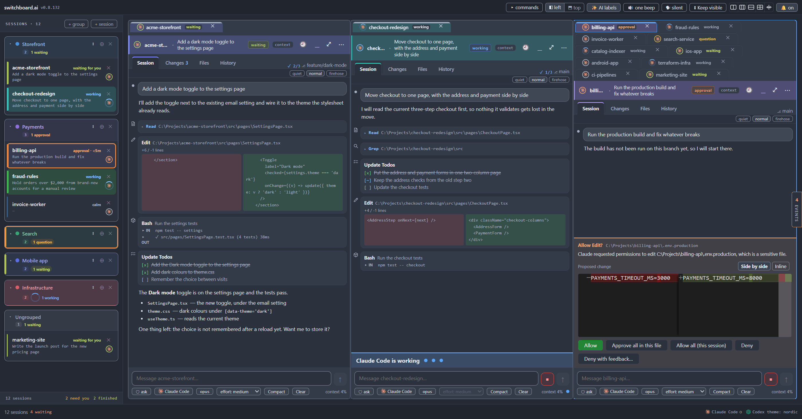

*Twelve sessions in five groups, three of them open side by side.*

It runs **your own `claude` command on your own Claude subscription**. There is
no API key, no account, and nothing is sent anywhere but to Claude.

---

## What it does

### Every session in one list, sorted into groups

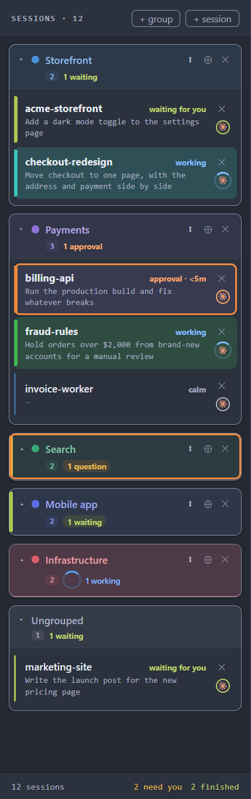

The **Sessions list** down the left is the whole inventory. Each row says what
its session is doing in a word or two (**working**, **approval**, **question**,
**waiting for you**, **calm**) and what it was last asked.

Put sessions into **groups** — one per product, client, or repo, whatever suits
you. Fold a group shut and its heading still says what is inside it
(**1 approval**, **2 working**), tinted in the colour of the most urgent thing,
so a folded group never hides a session that needs you.

The foot of the list keeps a running total: **2 need you · 2 finished**.

`Ctrl+1` to `Ctrl+9` jump straight to a session.

<br clear="right">

### …or across the top, for more room

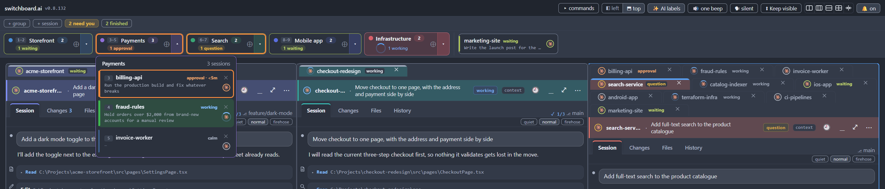

Prefer the full width for your sessions? Flip the list to **across the top**
with the **◧ left / ⬒ top** switch in the title bar (or in Settings, under
*Appearance*). Each group becomes one box with its status. Click a box and its
sessions drop down.

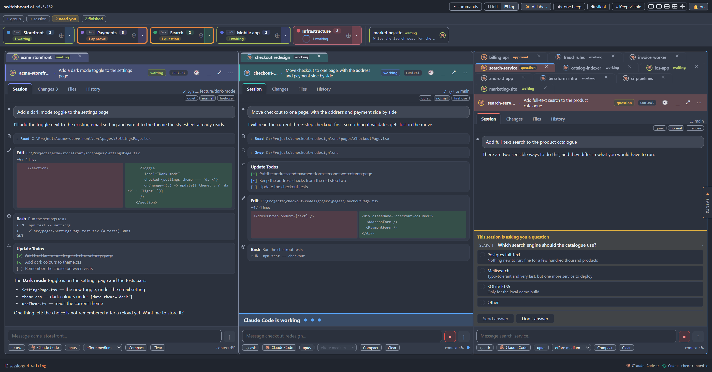

### Several sessions on screen at once

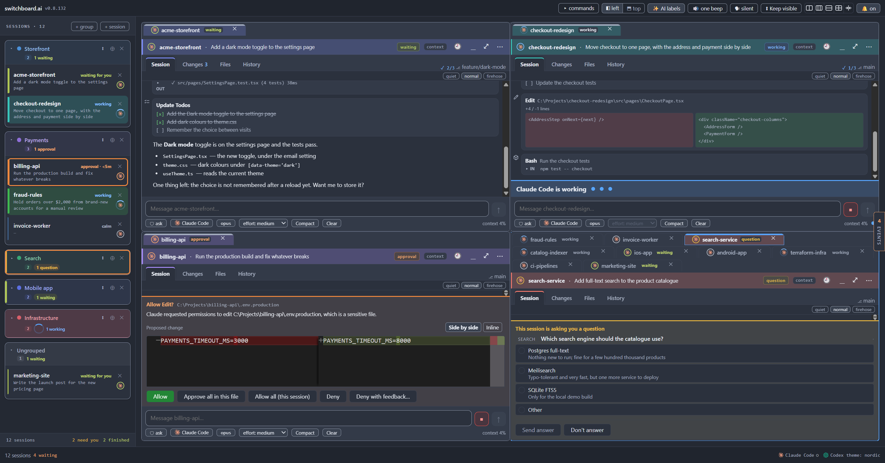

Open as many sessions side by side as your screen allows. One click arranges
them: **two side by side**, **three side by side**, **two rows**, or
**two by two**. Or drag tabs anywhere to build your own layout: split a card,
stack sessions as tabs, give one a full-height column. The layout is
remembered between launches.

Tear any session out into **its own window** for a second monitor; it keeps
running, and docking it back puts it exactly where it was.

### Knowing which session needs you

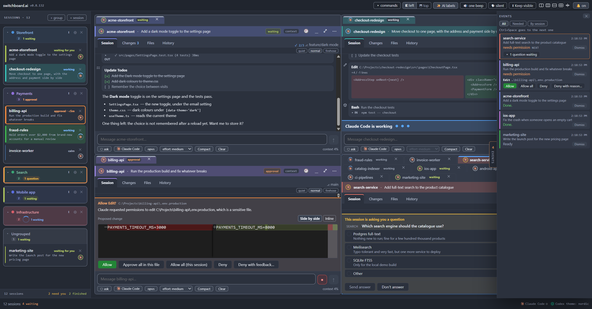

When a session finishes, asks a question, or wants permission, you hear it, the
row lights up, and it lands in the **Events drawer**, a to-do list of
everything waiting on you, most urgent first. `Ctrl+Space` takes you to the
next one.

You can also get desktop notifications, a spoken announcement, a sound of
your own for each session, or a push to your phone. Quiet hours turn all of
that off on a schedule.

### Approvals and questions, answered in place

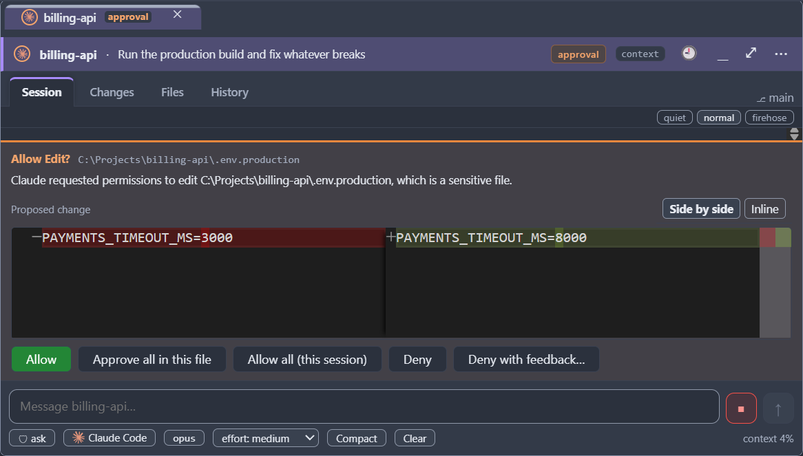

When Claude wants to run a command or edit a file, the request appears in the
session's card with the exact change, and you answer it there: **Allow**,
**Deny**, or deny with a note saying why. Each session has its own
**mode**, from *ask* (every action stops for you) up to *full-auto*.

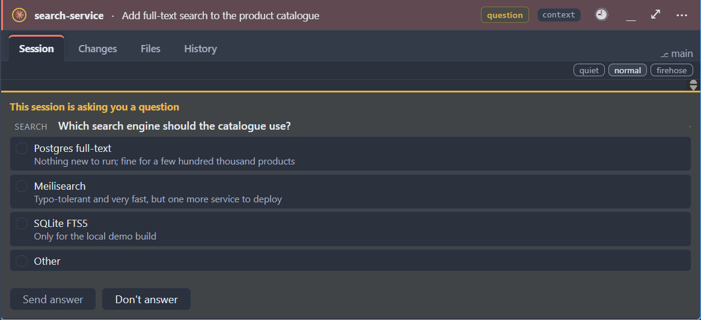

When Claude asks you a question, the choices appear as a short form. Pick one,
or write your own answer.

### Watching the work, not a terminal

Each session's **Session** tab shows the conversation as it happens: what
Claude said, every file it read or edited (with the change), every command it
ran and what came back, and its to-do list. Choose how much detail you want:
*quiet*, *normal*, or *firehose*.

Under the prompt box are the session's settings, one click each:

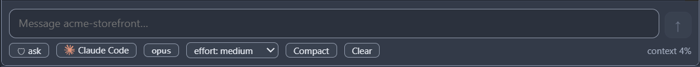

- **mode** (*ask* above), and which **AI** the session runs on. Claude Code
  comes first; OpenAI's **Codex** works too, and a session can switch between
  them.
- **model** and **effort**, changeable mid-conversation.
- **Compact** and **Clear**, and the **context meter**: how full the session's
  memory is, straight from Claude Code.

### Each session's changes, files and history

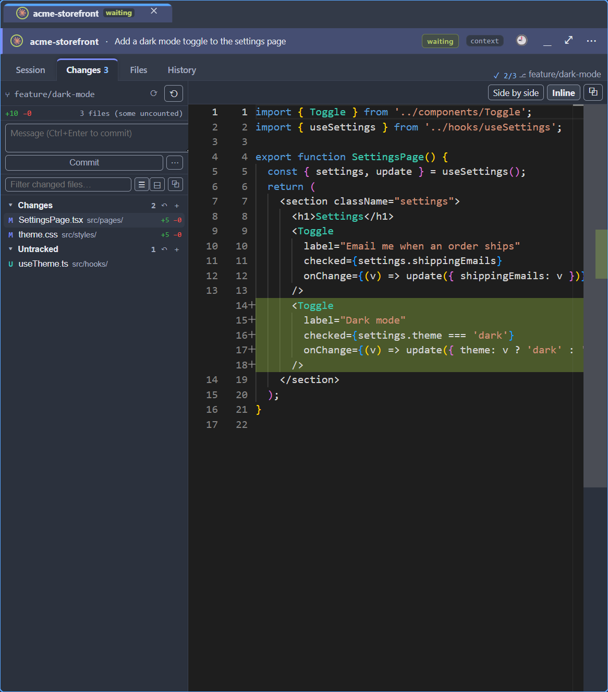

Every session has its own **Changes** tab (what it has changed in its folder,
file by file, with a diff, and a box to commit), a **Files** tab to browse and
read the project, and a **History** tab with the commit graph. You review a
session's work without leaving the app.

### Light or dark

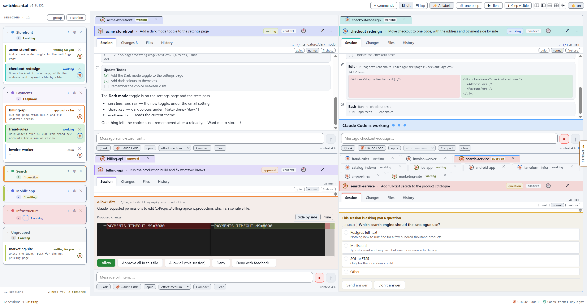

A dark theme, a light theme, and a high-contrast theme, in **Settings**
(`Ctrl+,`).

### And more

- **Sessions can work together.** A session can read another's recent work and
  send it a message, and you can hand a task to a fresh session with
  **Dispatch**.
- **Find** (`Ctrl+F`) searches a whole conversation, including what is folded
  out of sight.
- **Command palette** (`Ctrl+Shift+P`) for everything, and a keyboard route to
  every control.
- **Resume** a conversation after a restart, or open one you had before.
- **Is it me or is it them?** A status dot says when Claude itself is having
  trouble, so you don't go debugging your own setup.
- **Updates** are offered in the app, with the release notes, and installed
  only when you say so.

The [user manual](docs/manual/contents.md) covers all of it in plain English.

---

## Install

**Windows:** download `switchboard-Setup-<version>.exe` from the
[latest release](https://github.com/badsonstudios/switchboard.ai/releases/latest)
and run it. The app tells you when a newer version is out.

**macOS and Linux:** the app is cross-platform, but only the Windows build is
packaged so far. On a Mac or Linux, run it from source:

```
npm ci
npm run build
npm start
```

## What you need

- **Claude Code**, installed and signed in on your Claude subscription:

  ```
  npm install -g @anthropic-ai/claude-code
  claude    # once, to sign in
  ```

  That's all. **No API key.** If switchboard can't find `claude`, it says so
  in a banner and holds off on new sessions until it can.
- Optionally, **Codex**, if you want sessions on OpenAI's AI as well.
- To build from source: Node 22 and npm.

## The rules it keeps

- **Your subscription, not an API key.** It drives the `claude` command you
  already have.
- **Claude Code does the work.** switchboard shows, routes and notifies. It
  never changes what the agent decides, and never imitates a step Claude Code
  keeps for itself.
- **Everything stays on your machine.** No accounts, no cloud, no telemetry.
  Passwords and tokens go in your operating system's credential store.
- **If switchboard breaks, your session doesn't.** Its own failures never
  block the agent.
- **Every feature has to earn its place** against a written test (see
  PHILOSOPHY below).

## Read more

| | |
|---|---|
| [User manual](docs/manual/contents.md) | How to use every part of the app, in plain English |
| [CHANGELOG](CHANGELOG.md) | What changed in each version |
| [DESIGN](docs/DESIGN.md) | The design record: architecture, every feature's reasoning, the roadmap |
| [PHILOSOPHY](docs/PHILOSOPHY.md) | The principles, and the test every feature must pass |
| [PROGRESS](PROGRESS.md) | Live state of the work: what is being built now and what is next |
