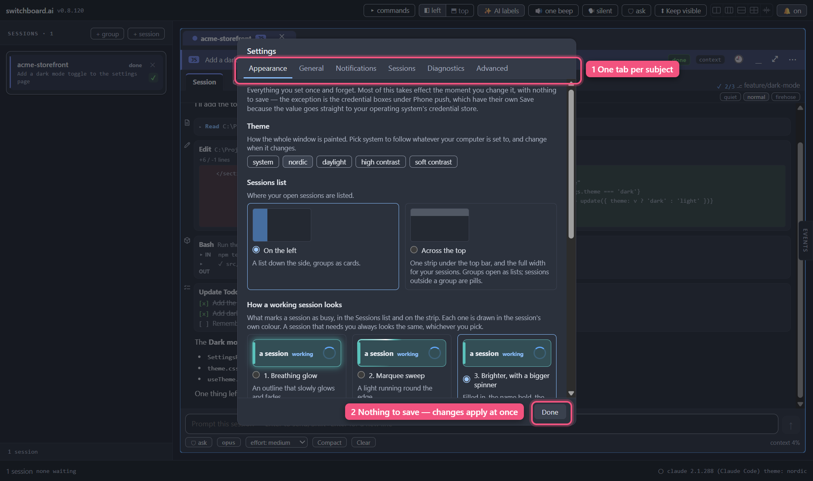

<a href="contents.md">☰ Contents</a>

# Settings

> Status: current

There are two places a setting lives, and which one it is in is a decision
rather than an accident.

## The Settings window

Choose **File ▸ Settings…** from the menu bar, or press **`Ctrl+,`**, or open
the command palette (**`Ctrl+Shift+P`**) and pick **Settings…**, or click the
version number in the title bar and press **Settings…** in the About panel.

`Ctrl+,` works everywhere.

Everything in it is something you set once and forget. There is **no Save
button** — every control takes effect the moment you touch it, and you can watch
the window behind change as you do. Close it with **Done**, **Escape**, or a
click outside.

It is organised in **seven tabs** along the top:

| Tab | Holds |
|---|---|
| **Appearance** | Theme, where the Sessions list goes, how a working session looks, the context meter, task label size |
| **General** | Language, automatic update checks, AI status-page checks |
| **AIs** | Which AI new sessions start on, the AIs found on this computer and their sign-in, adding another AI — see [Settings → AIs](24-ais.md) |
| **Notifications** | The needs-you sound, quiet hours, phone push & webhooks |
| **Sessions** | What happens to a finished dispatched session |
| **Diagnostics** | Detailed performance capture, and the file it writes — see [When it feels slow](19-performance.md) |
| **Advanced** | Fork sessions (experimental), and which screen switchboard's own automated tests use — see [Testing](#testing-which-screen-the-automated-tests-use) |

Click a tab, or put the keyboard on the tabs and use **`←`** and **`→`**
(**`Home`** and **`End`** jump to the ends). The window stays the same size
whichever tab you are on.

**It opens on the tab you were last on**, however you got there. The first
time, that is **Appearance**. Every tab opens at its top. Nothing you were in the middle of on another tab is lost when
you switch: a half-typed push key is still there when you come back.

Muscle memory still works: **`Ctrl+Shift+P` → *quiet hours*** (or *phone push*,
or *task label size*) opens Settings on the right tab.

## The chips that stayed in the title bar

Five settings did **not** move, and the rule is the same one for all of them:
*the person who needs it off needs it off **now***, mid screen-share, without
hunting through a window.

| Chip | Does |
|---|---|
| **🔔 on / 🔕 off** | All notifications |
| **🏷 auto labels / ✨ AI labels / 🏷 labels off** | Whether task labels are written from your prompts — see below |
| **🔊 session sounds / 🔊 one beep** | Whether each session gets its own sound |
| **🗣 announce / 🗣 silent** | Whether switchboard says out loud which session needs you |
| **🔓 auto-trust / 🔒 ask trust** | Whether new folders are trusted automatically. Greyed out, because nothing can ask any more — see below |

Three more chips are on the bar because they answer "why does the window look
like this?", and you need to be able to answer that by looking up rather than by
opening a window. (There used to be a fourth, the 🛡 mode chip. Each session's
own mode button, under its prompt box, replaced it; see
[Approvals and autonomy](04-approvals-and-autonomy.md).)

| Chip | Does |
|---|---|
| **◧ left / ⬒ top** | Where your sessions are listed: down the left, or across the top. The same choice as **Appearance ▸ Sessions list**. See [Listing sessions across the top instead](07-workspace.md#listing-sessions-across-the-top-instead) |
| **⬍ Keep visible / Collapse on submit** | What happens to a session's card when you send it a prompt — click to switch. See below |
| **Five small pictures of split boxes** | Arrange the open sessions in that shape with one click, or make the current arrangement even. See [Arranging cards with one click](07-workspace.md#arranging-cards-with-one-click) |
| **▦ Focus / Queue** | Only shown while one of those layouts is on (or a session is maximized), in place of the pictures. Click to step to the next layout |

## Language

**Settings ▸ General.** Two choices for now: **en** (English) and **pseudo**.

`pseudo` is not a translation. It takes every English word and mangles it into
accented look-alikes wrapped in `⟦ ⟧` — so anything that comes out plain is a
piece of text somebody forgot to make translatable. It is there for whoever adds
the second language, not for daily use.

**The switch covers the desktop pop-ups too**, not just the window: the text on
a notification, the **Allow** and **Deny** buttons on it, and the copy sent to
your phone or a webhook all follow this chip, and they change on the very next
notification with nothing to restart. What is *not* translated is anything that
came from Claude Code or from you — a command, a file path, a session name. See
[Notifications › Pop-ups follow the language you picked](09-notifications.md#pop-ups-follow-the-language-you-picked).

## Themes

**Settings ▸ Appearance.** Five buttons, and they are the whole picker:

- **system** — follow whatever your OS is set to, and change when it changes.
- **nordic** — the dark theme, and the default on a dark OS.
- **daylight** — the light theme.
- **high contrast** — a much starker dark theme for readability rather than
  looks: black surfaces, white text, bright status colors, and bordered edges
  instead of soft shadows. Pick it if the normal themes are hard to read.
- **soft contrast** — the same idea with the glare taken off: near-black
  surfaces instead of pure black, an off-white text instead of pure white, and
  a little depth back in the shadows. It is measured against the same
  readability standards as high contrast — softer to look at, not weaker.

Whatever you pick applies everywhere at once, including any session windows you
have popped out onto another monitor. Session colors — the little dot and stripe
that tell your sessions apart — deliberately do **not** change with the theme:
they identify a session, so they stay put.

Themes are plain data files, so more can be added without changing the app. A
way to write and import your own is planned, along with a screen for editing
individual colors.

## What a card does when you submit a prompt

The **⬍** chip sets this for every session at once. The default, **Keep
visible**, does nothing at all: the card stays put and you watch the turn come
in. The other, **Collapse on submit**, is opt-in: it folds the card away the
moment you send a prompt and brings it back when the session finishes or needs
you, so the space goes to whatever you're actually looking at. (A third
setting, *Hide on submit*, was removed in 0.8.124; if you had it on, it now
behaves as **Keep visible**.)

Individual sessions and groups can disagree with the chip: open the **⋯** menu on
a session's card, or use the **⬍** button on a group header. The full story,
including what it deliberately won't do, is in
[Organizing your workspace](07-workspace.md#getting-out-of-the-way-by-itself).

## What a session may do when it needs you

The other half of the same question, and it isn't a chip — it lives in the
command palette (`Ctrl+Shift+P`, search for *needs you*) and, for one session,
in the **⋯** menu on its card. Four settings: **always jump to it**, **jump only if
its card is on screen** (the default), **never jump, just mark it in the list**, and
**never jump, skip the queue**. (None of them touches sound or the taskbar
flash — that's the **🔔** switch above.) The full story is in
[Organizing your workspace](07-workspace.md#when-a-session-interrupts-you).

**Always jump to it** also brings the session's *window* to the front — the main
window, or the session's own window if it's popped out — even when you're in
another program. The other three never do. Two things to know:

- **Your computer gets the last word.** Windows sometimes refuses to let an app
  come forward on its own. When it does, the
  taskbar button flashes and the session is marked in the list instead.
- **Quiet hours and the 🔔 switch stop it.** Bringing a window forward counts as
  a notification, so during quiet hours, or with notifications off, your screen
  is left alone. The jump inside switchboard still happens.

Details: [Bringing the window to the front](07-workspace.md#bringing-the-window-to-the-front).

## Trusting folders

**There is no longer a trust setting, and there is nothing you need to do about
it.** The title bar used to carry a **🔓 auto-trust / 🔒 ask trust** chip. It has
been removed.

Claude Code asks whether you trust a folder the first time it runs there — but it
only ever draws that question inside its own terminal interface, and switchboard
no longer runs sessions there ([Direct mode](12-direct-mode.md)). It does not
raise the question any other way, so a session simply runs in the folder.
Measured against claude 2.1.226.

The chip spent a while greyed out, explaining that nothing could put the question
in front of you. A switch that can never do anything is worse than no switch —
and its explanation pointed at Terminal mode, which no longer exists — so it went.

**The important half is the part that has not changed: switchboard does not
answer the question on your behalf either.** It records no acceptance in Claude
Code's own settings for you. A folder switchboard has run in stays un-answered,
and the question is still there to be asked the first time you run `claude` in
that folder yourself, in a terminal of your own.

## Auto task labels

With **🏷 auto labels** on (the default), a session whose task label you have
not filled in shows the title Claude Code gave the conversation instead of
nothing. The full story — how it behaves, and why typing a label of your own
always wins — is in
[Sessions › The label writes itself](02-sessions.md#the-label-writes-itself).

Switch it to **🏷 labels off** before a screen-share or a demo. The label is
derived from what you asked, so it can put a phrase from your prompt on the
card, in the sessions list, and in desktop notifications; off hides all of them
at once and sends notifications back to using the session's name. **Labels you
typed yourself stay visible** — those are your words. Nothing is deleted, so
turning it back on restores everything instantly.

## AI task labels

**✨ AI labels** is the labels chip's **default** setting: switchboard asks
Claude to read what each session has recently been doing and write its task
label, refreshing it as the work moves on. It is the only setting in switchboard
that spends your Claude subscription, and it is careful about when — only when a
session finishes a turn, only when the conversation has actually grown, at most
once every ten minutes per session. **An idle session costs you nothing.**

Naming a card costs nothing at all: the instant you send a prompt, the label
becomes your own words, tidied. Claude's version replaces it when the turn ends.

Clicking the chip steps to **🏷 auto labels** — the free title Claude gives the
conversation, which describes how a session *started* rather than what it is
doing now — and clicking again hides labels altogether. Either of those stops
the spending immediately.

It only asks when a session finishes a turn, only when the conversation has
actually grown, at most once every ten minutes per session, and never more than
one at a time per session — so idle sessions cost you nothing at all. The check
runs with **no tools**: it cannot run commands, change files, or reach your
other sessions.

Turn it off and the spending stops at once. The full walk-through is in
[Sessions › Letting Claude write the label instead](02-sessions.md#letting-claude-write-the-label-instead-and-keep-it-up-to-date).

## How a working session looks

A session that is busy is marked in the Sessions list (and on the strip, if
your sessions are listed across the top), so a glance tells you which ones are
working. **Settings ▸ Appearance ▸ How a working session looks** has six ways
to mark it. Each choice is shown moving, on a sample, so you can see it before
you pick. Pick one and it applies at once; there is no Save button.

| | Look | What you see |
|---|---|---|
| 1 | **Breathing glow** | An outline in the session's colour that slowly glows and fades |
| 2 | **Marquee sweep** | A light running round the edge, with a faint tint |
| 3 | **Brighter, with a bigger spinner** *(what you get unless you change it)* | The row filled with the session's colour, the name in bold, a larger spinning ring round the AI's icon, and "working" in blue. Nothing moves but the ring |
| 4 | **Shimmer** | A band of light sweeping across |
| 5 | **Progress strip** | A thin bar running along the bottom edge |
| 6 | **Dancing bars** | Four bouncing bars beside the AI's icon instead of the spinning ring, and a steady outline |

Things that are true of all six:

- **They use the session's own colour**, so two busy sessions do not blur into
  one. No session is yellow or orange, so a busy session never looks like one
  that needs you.
- **A group on the strip is marked the same way** while a session inside it is
  working, in the group's colour, so you can tell without opening it.
- **A session that needs you looks the same whichever you pick.** These only
  change how a *working* session looks, and it stays the quieter of the two.
- **If your system is set to reduce motion**, the moving ones hold still: the
  outline, tint or bar stays, and the movement stops.
- The choice is remembered.

## Context meter

Under each prompt box, at the bottom right, a small meter shows how full that
session's context is (see
[The context meter](03-session-view.md#the-context-meter)).
**Settings ▸ Appearance ▸ Context meter** chooses how it is drawn. Each choice
has a small sample beside it. Pick one and it applies at once, to every
session; there is no Save button.

| Choice | What you see |
|---|---|
| **A number** *(what you get unless you change it)* | `context 62%` |
| **A bar** | A short bar that fills from the left. The number joins it from 60% |
| **A bar and a number** | Both, always |

Whichever you choose, it is plain grey below 60%, blue from 60% and red from
80%.

## Task label size

*This changes one thing: how big each session's task label is. To make
**everything** bigger or smaller, zoom the window instead — `Ctrl+=`, `Ctrl+-`
and `Ctrl+0`, described under [keyboard shortcuts](06-keyboard.md). The two
add up: zoom multiplies whatever label size you pick here.*

**Settings ▸ Appearance.** How much of each label you see.

| Setting | What you get |
|---|---|
| **Full** | Up to three lines. The default — Claude is asked for a phrase, and this is the room to read it |
| **Medium** | Up to two lines. A compromise when you are running a lot of sessions |
| **Compact** | One line, trimmed with an ellipsis — exactly how labels looked before this setting existed |

It applies to both places a label appears: the card header and the sessions
list. Nothing is lost at the smaller sizes — the label is still there in full,
and it is still read out in full to a screen reader; you are only choosing how
many lines of it are drawn. The change takes effect immediately, on sessions
that are already open.

## What's remembered

Your theme, language, notification setting, auto-label setting, **AI-label
setting** (on unless you turn it off), **task label size**, autonomy default, what cards do on
submit (global, per group and per session), what a session may do when it needs
you (global and per session), layout, groups, sessions, per-session detail
level, and window position all persist across restarts, stored on your machine.

## When another session needs you

**Settings ▸ Notifications.** On unless you turn it off. While you're working in
switchboard, a session you're not in that asks for permission or asks you a
question plays a sound of its own, and an approval plays it once more with a
minute left. **Play it** lets you hear it. Full walk-through in
[Notifications](09-notifications.md#when-another-session-needs-you).

## Quiet hours

**Settings ▸ Notifications.** Off until you set a window. Two times on your machine's clock, between which
nothing pops up, beeps, speaks or reaches your phone — webhooks keep going,
deliberately. Full walk-through in
[Notifications](09-notifications.md#quiet-hours).

Stored with your workspace, so it survives restarts like everything above.

## Phone push & webhooks

**Settings ▸ Notifications.** Off until you set it up. Full walk-through in
[Notifications](09-notifications.md#getting-told-on-your-phone).

Anything you paste in there — an ntfy topic, Pushover keys, a webhook URL —
goes into your operating system's credential store, never into a switchboard
file, so it is **not** part of "what's remembered" above and does not travel
with your workspace.

## The rest: Sessions, General and Advanced

One choice and three switches. They used to sit together at the bottom of the
window under "Advanced"; each is now on the tab it belongs to.

- **Finished dispatched sessions** (**Settings ▸ Sessions**) — what happens to
  a dispatched session's card once you have taken its findings, or once it turns
  out it had none. **Close it after half a minute** is the default: long enough
  to open the card and read the whole review first. **Close it straight away**
  is tidier and can startle you, because the card goes in the same moment you
  click Inject. **Leave it open** means nothing closes itself. Whatever you
  pick, five things keep a card open: findings you have not taken, a pin,
  carrying on the conversation, an unsent message, and a crash. See
  [Dispatch](20-dispatch.md).
- **Fork sessions** (**Settings ▸ Advanced**) — experimental, off by default.
  Turning it on adds **Fork into a new session** to a session's **⋯** menu,
  which starts a second session already carrying the whole conversation. It
  leans on Claude Code behaviour that isn't documented, so if an update ever
  breaks it, switch it off here and nothing else changes.
- **Check for updates automatically** (**Settings ▸ General**) — on by default.
  Off, switchboard never reaches the release host on its own; the **Check for
  updates…** button in the About panel still works whenever you ask it to. See
  [Updates](13-updates.md).
- **Get beta releases** (**Settings ▸ General**, under **Updates**) — off by
  default. On, you're also offered beta versions: early builds of the next
  release, labelled as betas. Turning it off while on a beta doesn't downgrade
  you; you wait for the next regular release. See
  [Updates ▸ Beta releases](13-updates.md#beta-releases).
- **Check provider status** (**Settings ▸ General**, under **AI status page**)
  — on by default. It asks the status page of the AI new sessions start on
  (Anthropic's, for Claude Code), and is what colours the dot in the status
  bar. An AI with no status page is never asked. Off, the dot goes grey and says
  why. See [Provider status](14-provider-status.md).

Those last two are the **only** two things switchboard sends over the network
without being asked, which is why they sit together.

## Testing: which screen the automated tests use

At the very bottom of **Settings ▸ Advanced**. **You only need this if you work
on switchboard itself.** Its automated tests open a lot of real windows, about
160 in a full run. This setting decides which screen they open on, so they stay
off the one you are working on.

It lists every screen attached right now, so you can tell them apart: its
number, its name, its size, and where it sits compared with your main screen
(for example *Screen 2 — 3840×2160, to the right*). The first choice, **Primary
screen (default)**, is your main screen, which is where the tests go if you
never touch this. Pick a screen and that is the whole job. Every copy of the
project on this computer uses it the next time the tests run.

- **Unplug the screen you picked** and the tests go to the primary screen
  until it is back. Settings keeps your choice and says *Not attached — tests
  run on the primary until it is back.* Plug it in again and it is used again.
  Unplugging a **different** screen does not change which one you picked.
  Plugging in a **new** screen, moving a screen to another cable or port, or
  changing which screen is your main one can change it. If that happens,
  Settings ticks the screen the tests will now use, so check it there and pick
  again.
- **The screen numbers are names for this list only.** Settings calls your main
  screen *Screen 1* and numbers the rest from left to right. If you set the
  variable by hand to a number, the tests
  count screens differently, so *Screen 3* here may not be `3` there. Pick the
  screen here instead.
- **Where it is saved:** in a small file in your home folder called
  `.switchboard-e2e.env`, which the tests read. Settings changes only its own
  line in that file and leaves any other lines alone. Settings shows the full
  path under the list.
- **If the file cannot be saved** (or read), Settings says so under the list,
  and nothing else changes.
- **A `SWITCHBOARD_E2E_MONITOR` variable set in the shell that runs the tests
  wins over this.** Settings cannot see a variable like that, so if the tests
  ignore your choice, check for one.

Under the list of screens is one more box: **Open test windows without taking
focus**. Tick it and the tests' windows open in the background, so you can keep
typing in another program while they run. It is saved in the same file, as the
line `SWITCHBOARD_E2E_NO_ACTIVATE=1`; unticking it removes that line. If the
file is missing it shows unticked. As with the screen, a
`SWITCHBOARD_E2E_NO_ACTIVATE` variable set in the shell wins over the box.

## Good to know

- switchboard has no account, no cloud sync, and sends no telemetry anywhere.
- Credentials for **Claude** are handled by Claude Code itself, on your
  subscription. There is no API key to enter and switchboard never stores one.
  The only credentials switchboard holds are the phone-push / webhook ones you
  choose to give it, and those live in the OS credential store.

TODO: a notification-rules editor (which would replace hand-editing the
`quietHours` override) is not built yet.

---

[← Back to Contents](contents.md)
