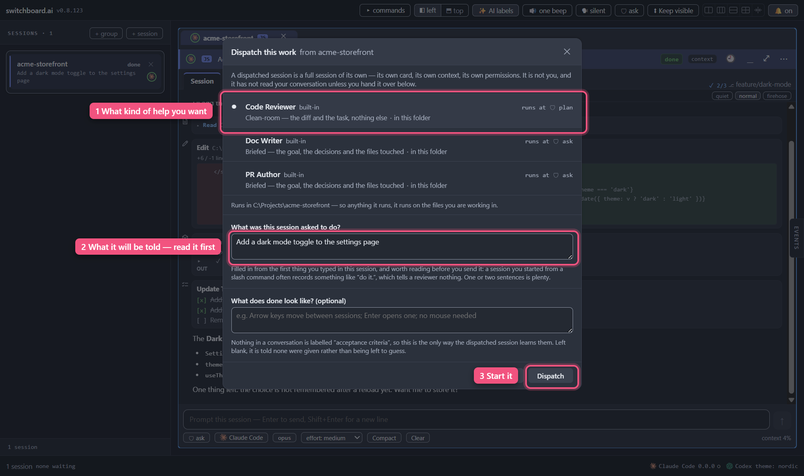

<a href="contents.md">☰ Contents</a>

# 20 — Handing work to a fresh session

Sometimes the most useful thing you can do with finished work is show it to
someone who has never seen it before.

A review run inside the session that did the work tends to agree with itself. It
knows why you made every choice, so it judges whether you did what you meant to
— not whether what you meant to do was right. A session that has only the change
in front of it has to work out what the change is for, and that is exactly when it
notices the thing you both assumed.

**Dispatch** is how you do that without opening a new window and re-explaining
yourself. You pick a role, say in one line what the work was meant to do, and
switchboard starts a new session that has been handed precisely that and nothing
else.

<!-- screenshot: the Dispatch dialog with Code Reviewer selected -->

## Sending work off

From the session whose work you want looked at:

1. Click the **⋯** button in the card's header.
2. Choose **Dispatch…**.
3. Pick a role.
4. If you picked **Code Reviewer**, read the **What was this session asked to do?**
   line — see below, because this is the part worth ten seconds — and optionally
   fill in **What does done look like?**
5. Click **Dispatch**.

Those two boxes only appear for Code Reviewer, and that isn't an oversight: it is
the only role that gets nothing but the change itself, so it is the only one that
needs you to say what the change was for. The other two are handed the goal and
the decisions your conversation already recorded, so there is nothing for you to
type.

A new session appears, named after the role — *Code Reviewer of my-project* — and
its first message is already there. You don't have to type anything to start it.

## Where the new session works

**In the same folder as the one that sent it.** The box tells you which folder,
under the list of roles, before you press anything.

That is worth a moment's thought when you ask a dispatched session to run
something. It is looking at the same files you are, so a test run or a build
happens in the tree you are working in — not in a copy of it. If you are
mid-edit, it sees your half-finished edit.

Giving a reviewer its own separate checkout is the obvious fix and it is coming
with the git work in a later release. Until then switchboard would rather tell
you where the session is than quietly put it somewhere and let you assume
otherwise. A role can *ask* for its own checkout — the setting exists — and if
one does, the box refuses it by name rather than dropping it into your folder
without saying so.

## Run it on: a review by a different AI

If you have more than one AI set up — Claude Code and Codex, say — the box has a
**Run it on** row under the roles. It picks which AI the new session runs on:

- **Same as this session** comes first and is chosen to begin with. That is what
  Dispatch has always done.
- **Every other AI you have set up** follows, by name. Pick one, and the new
  session starts on that AI instead.

The point is a second opinion. A different AI reviewing the work is less likely
to share the blind spots of the one that wrote it.

**The findings come back the same way.** When the review is done, the row
appears in **Events** on the card that sent it, and **Inject findings** puts the
report in that card's message box. Which AI wrote the report makes no
difference. The other AI is handed exactly what a same-AI review is handed:
for Code Reviewer, the change, the task line and your criteria, and nothing
else.

**An AI that is not logged in is dimmed** and says *not logged in*. You can still
click it to see the reason, but **Dispatch** stays off until you log in to it or
pick another AI.

The login state is what switchboard last found when it checked your AIs. It
checks each one when the app starts, and again after you log in from inside the
app. If you log in or out in a terminal instead, the box only catches up after
you restart the app. An AI switchboard hasn't checked yet is shown as
available. If it turns out not to be logged in, its own session says so when it
starts.

**A role can prefer an AI.** One of your own roles can name the AI it would
rather run on, and the box then picks that AI for you. If that AI is not set up
on this computer, or is not logged in, the box says so in a sentence such as
*"Second opinion prefers Codex, which is not logged in"*. **It does not quietly
run the role on a different AI instead.** You pick another AI yourself, or
Dispatch stays off. A review you asked a different AI to do should never turn
into one by the same AI without you knowing. The three built-in roles prefer no
AI, so they always start on the same AI as the session that sent them. Like the
rest of your own roles, the preference is written into your workspace file by
hand for now (`"preferredProviderId": "codex"` on the role).

A few things differ when the other AI is Codex:

- **Code Reviewer still cannot change your files.** On Codex its **plan** setting
  becomes Codex's own read-only mode.
- **Handing over the whole conversation only works on the same AI.** Each AI
  stores its conversation in its own format, so the role that forks your
  conversation is refused when the AI is different, with the reason shown
  before you press anything. Use a briefed role instead: it writes the handoff in
  plain text that any AI can read.
- **Every dispatch spends usage on the AI it runs on.** A Codex review uses your
  Codex plan, not your Claude one.

**This is the only place you can choose a second AI for now.** There is no
button yet that starts an ordinary session on Codex, or switches a card from
one AI to another. Those come with the AI switch in a later release. Until then,
Dispatch's **Run it on** is the one way to put a session on another AI from the
app itself.

You can also do this from the command palette (`Ctrl+K`): type *dispatch* and
you'll see one entry per role. They open the same box with that role already
chosen. There's no keyboard shortcut for it on purpose — dispatching starts a
session and spends part of your Claude usage, so it shouldn't be one mistyped
chord away.

## Read the task line before you send it

For **Code Reviewer**, the box fills that line in from the first thing you typed
in the session. That is often not what you'd say if someone asked you.

If you started the session with a slash command, the first *sentence* you typed
may well have been something like "do it." — which is true, and useless to a
reviewer. One sentence of your own is worth more than everything else in the box.

If you clear the line entirely, the new session is told the task isn't known,
rather than being handed a guess. That's a fair choice; just make it on purpose.

## The three roles that come with the app

| Role | What it's handed | What it can do |
|---|---|---|
| **Code Reviewer** | Only the change itself: the diff, the task, your criteria. None of your conversation. | Reads and reports. It cannot change your files. |
| **Doc Writer** | A briefing: the goal, the decisions, the files touched. | Asks before changing anything. |
| **PR Author** | The same briefing. | Asks before changing anything. |

**Code Reviewer deliberately does not get your conversation.** That's the whole
point of it, and it's why its findings are worth reading: it had to reconstruct
what the change was for, so anything it had to assume is something the change
doesn't say out loud.

The other two do get a briefing, because you can't write documentation or a pull
request from a diff alone.

### Your own roles

These three are built into the app, so they improve when you update. You can add
your own, and a role you write is treated exactly like a built-in one — same
list, same box, same behaviour. For now that means adding it to your workspace
file by hand; a proper editor is still to come — which is also why there is
nowhere yet to *pick* a role's folder setting. You can write one into the file,
and the box will tell you it can't carry it out.

Editing one of the built-in three gives you a copy rather than changing the
original, so an upgrade can't undo your version and your version can't be undone
by an upgrade.

## What a dispatched session is — and isn't

It's **a session like any other**. Its own card, its own tab, its own
conversation, its own permissions. You can click into it, read it, type at it,
and close it. It is not a helper thread hiding inside the session that started
it: if you close the original, this one carries on.

It also **doesn't know what you've said since**. It was handed a snapshot at the
moment you pressed Dispatch. If you change things afterwards and want them
looked at, dispatch again.

## Code Reviewer won't touch your files

It runs in **plan** mode, which is Claude Code's own read-only setting rather than
anything switchboard layers on top. It can read and explore as much as it likes;
it cannot edit.

One consequence worth knowing: if a reviewer decides it wants to write its
findings to a file, it will ask permission to leave plan mode — and because
nobody is sitting in front of a dispatched session, switchboard answers *no*
immediately and tells it to report its findings as its reply instead. You'll see
the findings in the session. Nothing is lost, and nothing sits waiting for a
click you were never going to make.

**Once you type into a dispatched session, that stops.** Typing is how switchboard
knows somebody is there, so from then on it asks you about leaving plan mode like
any other session would.

## Getting the findings back

When a dispatched session finishes, a row appears in **Events** — on the card
that *sent* it, not on the new one. Open Events with the tab on the right, or
press `Ctrl+Space` to jump to whatever is waiting for you.

<!-- screenshot: an Events row reading "Code Reviewer 'Code Reviewer of my-project' finished and reported back", with Inject findings and Open it -->

The row says which role finished, and shows the first line of what it wrote —
usually the sentence that tells you whether you want to read the rest. It has two
buttons:

- **Inject findings** puts the whole report into the sending session's message
  box, marked as coming from the session that wrote it. **It does not send it.**
  You read it, edit it if you like, and press Enter — exactly as you would with
  anything one session passes to another. Once you've clicked it the row changes
  to say where the findings went and the button disappears, so you can't hand the
  same report over twice. (If you've switched that card to accept messages from
  other sessions automatically, it goes straight in, and the row says that
  instead rather than pretending it is waiting.)
- **Open it** takes you to the session that wrote the report, so you can read the
  whole conversation instead. If you've already closed that session, the row says
  so and the Inject button still works — switchboard is holding the report, not
  the card.

If the hand-over doesn't work — the card was closed, or it already has as many
messages waiting as it can hold — the row tells you why and **keeps the button**.
A click that landed badly never costs you the findings.

The report is the reviewer's last reply — the findings themselves, not a summary
switchboard wrote. If it's very long it's shortened, and the row says so.

**The row does not count the findings.** A review is prose, and different runs
number their points in different ways — or don't number them at all — so any
count printed here would sometimes be wrong. You get the reviewer's own opening
line instead, which is always true.

You'll get a row even when there is nothing to inject. If the session stopped
before it finished, or finished without writing anything, the row says that
rather than leaving you waiting for a review that isn't coming. **Dismiss** on
the row clears just that row; the sending session's own status is untouched.

### One thing to know about closing cards

If you close the *sending* session's card, its waiting findings go with it —
there's nowhere left to put them. Closing the *reviewer's* card is fine: the
report is held by the app, so **Inject findings** keeps working. The one thing
you lose is the name on the block: without the original session around to name,
it arrives attributed to an unknown session.

That is only ever a cost of closing a card **by hand**. When switchboard closes a
dispatched session for you (below), it does so *after* the findings have been
handed over, so the name on the block is always the real one.

## Where it sits in the sessions list, and when it goes away

A dispatched session appears **indented under the session that sent it**, with a
small ↳ in front of its name. That is the whole of it — it is still an ordinary
row: you can click it, rename it, drag it, pin it, and jump to it with
**Ctrl+1–9** exactly as you would any other. The numbering counts the indented
rows in the order you see them, so what your eye reads as fourth is what Ctrl+4
opens.

The indent survives a restart. It also **quietly goes away** in the cases where
drawing it would be a lie: close the sending session and its reviewer simply
becomes an ordinary top-level row rather than an arrow pointing at nothing. The
same is true if the two end up in different groups, or if you pin one of them —
a pinned session always sorts to the top of its group, and switchboard would
rather drop the indent than break that promise.

### Dispatched sessions clean themselves up

A dispatched session exists to do one job, so by default its card **closes itself
thirty seconds after you have handed its findings over** — or as soon as it turns
out there were none to hand over. Thirty seconds is enough to open the card and
read the whole review if you want to.

Five things keep a card open, whatever the setting says:

- **Findings you have not taken yet.** As long as the row in the Events list is
  still offering you **Inject findings**, the session that wrote them stays.
  Nothing throws away a review you have not read — and that includes findings
  owed to *this* card, if it went on to dispatch a session of its own.
- **A pin.** Pinning is how you tell switchboard "not this one" everywhere in the
  app, and this is no exception.
- **Carrying on the conversation.** If you type at it and send, the card is not
  closed out from under you.
- **An unfinished message.** Anything you have typed into its box and not sent
  keeps the card — closing it would take your words with it.
- **A crash.** If the session died, its card is the only place the reason is, so
  it stays until you close it yourself.

You can change all of this in **Settings → Sessions → Finished dispatched
sessions**: close it straight away, close it after half a minute (the default),
or leave it open and close cards yourself.

**Closing is closing — there is no archive yet.** A closed session's
conversation is still on disk and can be re-opened from history, but switchboard
does not keep a browsable record of dispatched sessions. That arrives with the
session-archive work in a later release.

## When Dispatch is greyed out or refuses

- **No **Dispatch…** in the ⋯ menu** — the session hasn't started yet. There's
  nothing to hand over from a session that has never run.
- **A role is greyed out in the box** — its reason is printed under its name.
  Usually it wants a feature that isn't switched on or isn't built yet, and the
  message says which.
- **"Handing over the whole conversation needs session forking…"** — that role
  wants to pass on your entire conversation, which is an experimental feature.
  Turn on **Fork sessions** in Settings → Advanced, or pick **Briefed** instead.
- **"Dispatching into a fresh worktree is not available yet"** — that role wants
  its own separate checkout of your code. That arrives with the git work in a
  later release. For now a dispatched session works in the same folder as the
  one that sent it, which is worth remembering if you ask it to run tests.
- **"… prefers Codex, which is not set up on this computer"** or **"… which is
  not logged in"**: the role names an AI you can't use right now. Pick another
  AI under **Run it on**, or log in to that one first.
- **"The AI chosen to run this is no longer set up"** or **"… is not logged
  in"**: something changed while the box was open. Pick another AI, or log in,
  and press Dispatch again.
- **The new card says "This was dispatched to … which is no longer set up"**:
  the AI you picked was removed (for example a "Something else" AI deleted in
  **Settings ▸ AIs**) after you pressed Dispatch but before the session
  started. switchboard does not quietly run the role on a different AI
  instead. The card names the AI that is gone and has a **Settings → AIs**
  button. Add that AI again **with the same name** (a "Something else" AI is
  known by its name, so a different name is a different AI) and press **Try
  again**: the briefing is kept for about fifteen minutes, so the session still
  gets it. After that the card tells you the briefing has expired (next item).
  Or close the card and dispatch again on another AI.
- **The new card says its briefing "has expired"**: switchboard keeps what a
  dispatched session is going to be told — its *briefing* — for fifteen
  minutes, and this card didn't start in time. That happens when a dispatched
  card sits out of sight (in a hidden or background tab) for that long before
  you look at it, or when you press **Try again** on a card that didn't start
  more than fifteen minutes after dispatching it. Nothing has run in the card,
  and switchboard won't start it without its briefing — it never quietly
  starts a plain session instead, or switches it to your default AI. The card
  names the AI it was for and the session that sent it. Press **Dispatch
  again**: the Dispatch box opens from that session with the same role picked,
  and makes a fresh card; then close the old one. (If the session that sent it
  has been closed or suspended, there's no button — dispatch again from wherever that work
  is now.) A briefing also doesn't survive quitting switchboard, so dispatch
  and look at the card in the same run.

## What doesn't happen yet

- **Nothing re-runs the review after you fix things.** Fix, re-dispatch, read
  again — there's no loop that does the rounds for you.
- **Nothing shows you the chain of a piece of work.** switchboard records which
  session dispatched which, so a future release can show you "written here,
  reviewed there, fixed back here". Today the record is only used for the indent
  in the sessions list.
- **Nothing dispatches on its own.** There is no rule that sends a review off
  when a session finishes, and a session cannot dispatch another one by itself.
  Every dispatch is a button you pressed.

---

[← Back to Contents](contents.md)
